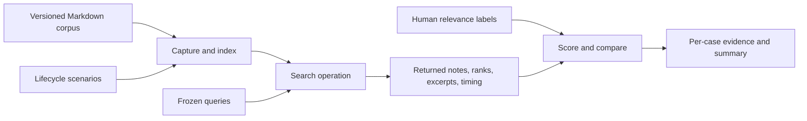

# Note search evaluation

**Status:** Draft for review. Search, the dataset, and the evaluation runner are not
implemented. This document defines the proposed framework; it records no scores.

**Scope:** Local keyword search over captured notes, initially using SQLite FTS5.
The current parser/indexer produces `NoteIndex`; keyword search is the next
proposed feature. This suite evaluates that feature before expanding to semantic
retrieval or agent answers.

## 1. Questions the suite must answer

1. Does search return only eligible notes from the requested vault?
2. Can users find the right notes near the top of the results?
3. Does search stay correct after edits, deletion, reindexing, and migrations?
4. What are the query latency, indexing cost, and storage cost as the corpus grows?
5. Did a proposed change improve results, and which individual queries regressed?

Keep correctness, retrieval quality, and performance separate. A fast search with
stale results fails correctness; a correct search with poor ordering needs ranking
work. An aggregate score must not conceal either problem.

## 2. Search contract to freeze before implementation

These are proposed behaviors from the search design, not shipped guarantees.

| Concern | Initial contract |
| --- | --- |
| Search fields | Parsed title and `searchable_text`; arbitrary frontmatter is not automatically searched |
| Matching | Case-insensitive word matching; all query terms must match, in any order and across either field |
| Query input | Plain text; input must not accidentally execute FTS operators or SQL |
| Tokenization | Pin the selected tokenizer and options; document punctuation and accent behavior before labeling related cases |
| Ranking | BM25; evaluate title weighting against equal title/body weights rather than assuming it helps |
| Eligibility | Requested vault, active note, `ready` state, matching indexed/source revision and required processor version |
| Results | Note ID, relative path, title, and a short source-backed excerpt; at most the requested limit |
| Stable ordering | Same corpus/configuration produces the same order, with a deterministic tie-break |
| Invalid input | Blank queries and invalid limits produce clear validation errors; decide length/term bounds before the runner is implemented |
| Empty results | Valid query with no matches returns an empty result, without an application error |

Substring, prefix, fuzzy, synonym, semantic, and advanced operator search are not
part of this initial contract. For example, ordinary word matching must not be
graded as broken because it cannot infer a synonym. Keep such examples as explicit
future capability cases, outside the initial pass rate.

## 3. Three evaluation tracks



### A. Correctness and synchronization

These are deterministic requirements. Each scenario specifies its initial state,
actions, observation point, expected result, and supporting database evidence.

| Area | Required scenarios |
| --- | --- |
| Vault isolation | Identical terms and filenames in two vaults; results never cross the requested boundary |
| Freshness | Editing a captured note hides its old index while pending; reindexing exposes only the new revision |
| Processor upgrade | An older processor's index is hidden until the required version is published |
| Deletion | Soft-deleted notes disappear immediately; physical deletion and cascading index deletion remain consistent |
| Recovery | A recovered file follows the current identity policy; the old deleted row is not returned alongside it |
| Failure | Failed parsing does not expose an older index as current; another note can still be searched |
| Atomicity | Failed publication or an enclosing transaction rollback cannot leave a partially published search result |
| Races | Update/delete between capture and publication rejects old work; a late failure cannot override successful current work |
| Repeatability | Reindexing unchanged notes does not duplicate search hits; ties remain deterministic on an unchanged snapshot |
| FTS synchronization | Insert, upsert, and delete NoteIndex rows; compare search with the eligible source records, not just row counts |
| Migration/rebuild | Existing indexes are backfilled; migration, rollback, reapply, and rebuild preserve captured notes and recover equivalent matches |
| Input and output | Quotes, operator-like input, punctuation, Unicode, invalid limits, blank input, no matches, and accurate excerpts |

Include an explicit expected error for invalid inputs. A normal error must not be
counted as a crash. Record unexpected exceptions separately. Validate excerpts
against the matched indexed revision; visual review covers readability. Preserve
heading/link labels and code content according to the parser's current behavior.

Do not require matches for metadata the parser excludes. Include free-form notes,
valid and malformed frontmatter, ATX and underlined headings, lists, code, and link
labels so the evaluation covers the actual Markdown-to-search path.

### B. Retrieval quality

Use a small, fully reviewed dataset first. Proposed starting size:

- 60 synthetic Markdown notes: 50 in the target vault and 10 in a second vault for
  isolation checks. Include short/long notes, duplicate titles, near duplicates,
  direct answers, supporting notes, and plausible distractors.
- 40 queries: 32 with relevant eligible notes and 8 with no eligible lexical match.
- Split queries into development and held-out evaluation groups, roughly 20 each.
  Keep related query variants together to avoid tuning on a near-copy of a held-out
  query. Preserve positive and no-match coverage in both groups.

Cover exact names, multiword queries, title-versus-body matches, rare/common terms,
code identifiers, Unicode, and hard distractors. Pin tokenizer behavior before
including accent or punctuation expectations. Vocabulary such as `C++` and `C#`
needs explicit review because a word tokenizer may discard distinguishing symbols.

These sizes are a starting proposal, not a completed dataset or a statistically
representative benchmark. Synthetic fixtures make failures explainable; separately
approved, anonymized real examples can later improve realism. Do not import the
user's vault or private conversations as evaluation data by default.

#### Relevance labels

A human judges usefulness for the query before reviewing engine rankings:

| Grade | Meaning |
| --- | --- |
| 2 | Directly satisfies the query's information need |
| 1 | Provides useful supporting information |
| 0 | Irrelevant, despite possible shared words |

Review every eligible note for every quality query in the small corpus. Record a
brief reason for each positive judgment and any ambiguous case. Do not derive
labels from BM25 scores, title matches, or the candidate's returned results.
Missing judgments must be resolved before scoring, rather than silently assigned
grade 0. Use stable fixture document IDs mapped to runtime note IDs after seeding.

Freeze corpus, queries, and labels before tuning. Changes to any of them create a
new dataset version. Tune on the development group; use the held-out group for a
comparison checkpoint, not repeated weight selection.

#### Metrics

Treat grades 1 and 2 as relevant for binary metrics. Compute each metric per query,
then average across the positive queries. Report query counts and category results.

| Metric | What it answers | Definition |
| --- | --- | --- |
| Recall@10 | Are useful notes present in the first ten? | Relevant notes returned in the first 10 divided by all relevant eligible notes |
| MRR@10 | How quickly does the first useful note appear? | `1 / rank` of the first relevant result in the top 10; 0 if absent |
| nDCG@10 | Are the most useful notes ranked ahead of weaker matches? | Discounted graded relevance divided by the best possible ordering for that query |
| No-match error rate | Does search return anything when no eligible note should match? | No-match queries returning at least one hit divided by all no-match queries |

For nDCG, use gain `2^grade - 1`, discount `log2(rank + 1)`, and ranks beginning at
1. Compute the ideal ordering from the complete eligible relevance labels. Recall
and nDCG are undefined for queries with no relevant notes: report them as not
applicable and score those queries separately. Duplicate results are a correctness
failure and never count as additional relevant notes.

The eight no-match queries must have no eligible match under the agreed keyword
contract, including cases where a term exists only in deleted, stale, or other-vault
notes. A semantically irrelevant note that contains all query terms is a ranking
distractor; zero-result behavior for that case requires a separate abstention design.

Start with equal-weight FTS5 BM25 as the ranking baseline. Compare the proposed
title boost against it using identical query semantics, tokenizer, corpus, and
eligibility filters. Inspect per-query rank changes, not just the mean. Raw BM25
scores are not comparable across corpus versions or different search engines.

### C. Performance and resource cost

Measure separately on reproducible synthetic corpora of 1,000 and 10,000 notes.
Record document size distributions and vocabulary; repeating one note thousands
of times is not a useful scale model. These corpora measure cost, not relevance.

| Measurement | Method |
| --- | --- |
| Query latency | Time the shared search operation through complete bounded result materialization; report p50 and p95 |
| CLI overhead | Measure process startup plus search separately from the shared operation |
| Warm versus first query | Report the first query after opening separately; warm up before the repeated query mix. Do not call this an OS cold-cache benchmark |
| Index build/backfill | Time from prebuilt NoteIndex records to completed FTS synchronization; exclude fixture generation |
| Incremental update | Measure capture/index/search visibility separately, including publication and its triggers |
| Storage | Compare the same prepared database with and without FTS after checkpointing; report database/WAL sizes and indexed text bytes |

Use at least 100 measured query executions per corpus per run and three runs.
Include common, rare, multiword, and no-match queries. Fix the query mix and order
with a recorded seed, retain raw timings, and report the sample count and percentile
method. Do not include fixture generation or report writing in query latency.

Record machine/OS, Python/SQLite versions, FTS5 availability, journal/cache settings,
concurrency, corpus size/bytes, and all search settings. Keep concurrent readers or
writers as a separate workload. Do not compare runs on different hardware or
settings without identifying those differences.

## 4. Release decisions

| Evidence | Initial decision rule |
| --- | --- |
| Correctness | All required cases pass; zero cross-vault, deleted, or stale hits; zero duplicate hits and unexpected exceptions |
| No-match behavior | Zero unexpected hits on the curated no-eligible-match cases |
| Relevance | Establish the equal-weight baseline first. Review every regressed query and category before accepting a ranking change |
| Latency/storage | Establish measured baselines first; approve numerical budgets using those measurements |
| Missing evidence | Mark the result incomplete; do not count unrun scenarios as passing |

Do not invent a universal quality percentage or millisecond target before the
dataset and first measurements exist. Freeze explicit relevance and performance
budgets after baseline review. A critical correctness regression blocks promotion
even if average quality or latency improves. Show small-corpus comparisons as
paired query results; do not claim statistical significance from a small score
change without appropriate evidence.

## 5. Artifacts and reproducibility

Only this design and the suite index exist in this step. Proposed artifacts for a
later approved implementation:

```text
core/src/hippo/evaluation/search_engine/
  README.md              # This design
  manifest.json          # Dataset version, split, hashes, tokenizer contract
  corpus/                # Synthetic Markdown in named fixture vaults
  queries.jsonl          # Stable query ID, text, vault, category, split
  judgments.jsonl        # Query ID, fixture document ID, grade, rationale
  scenarios.jsonl        # Initial state, actions, expected observations
```

Executable loading, running, and scoring also belong in this `search_engine/`
folder. Other component evaluations, such as `evaluation/dreamer/`, own their
corresponding structures independently. Add one local command only when the
runnable search evaluation path is implemented. No evaluation command is available yet.

Store generated reports under `sandbox/evaluation-results/search_engine/<run>/`:

- A machine-readable report with run time, dataset version and hashes, source
  revision plus working-diff hash, migration and parser versions, search settings,
  environment, baseline reference, and measured metrics.
- Per-query evidence: query ID, returned document IDs in order, their grades,
  excerpts, timings, and differences from baseline.
- Scenario evidence: actions, expected/actual observations, errors, and pass/fail.
- A readable summary: hard failures first, metrics with denominators, category
  regressions, performance distributions, and the resulting decision.

Run only against a disposable database initialized by the real migrations. Use
the actual capture/index/publication/search path for end-to-end evidence. A
prepared-index run may isolate search performance, but must be labeled separately.
Never use evaluation execution to mutate the configured user database.

Manual review remains useful: inspect representative top-five results, explanations
for misses, and excerpts. No LLM judge is needed for deterministic keyword search;
human judgments supply the relevance labels and deterministic metrics score them.

## 6. Ordered delivery checklist

- [ ] Review this design and finalize query/tokenizer/input-bound behavior.
- [ ] Create the corpus, queries, complete relevance labels, and development/held-out split.
- [ ] Review the labels and freeze dataset version 1.
- [ ] Implement the reviewed FTS storage, synchronization, query operation, and CLI.
- [ ] Implement the explicitly reviewed evaluation runner and scoring functions.
- [ ] Run correctness cases and the equal-weight ranking baseline on a disposable DB.
- [ ] Compare title weighting on the development queries and review regressions.
- [ ] Evaluate the selected configuration on held-out queries.
- [ ] Measure scale workloads and agree numerical quality/performance budgets.
- [ ] Retain the baseline report and compare future changes against it.

These are future steps, not completed checks. Search implementation remains subject
to the project's step-by-step approval workflow. This documentation step adds no
automated test infrastructure and runs no evaluation.

## References

- [SQLite FTS5](https://www.sqlite.org/fts5.html): tokenization, MATCH semantics,
  external-content synchronization, BM25, snippets, and rebuilding indexes.
- [Evaluation component](../README.md): each component owns its evaluation design,
  fixtures, and eventual runner under `hippo.evaluation`.
- [Core specification](../../../../../docs/specs/02-core-application-structure.md): shared
  knowledge behavior belongs in the Python core; derived storage is rebuildable.

The broader Obsidian specification, `051 - Agent evaluation`, calls for narrow
task suites, repeatable inputs, shared baselines, and failure evidence. Its later
agent-memory benchmarks are outside this keyword-search suite.
