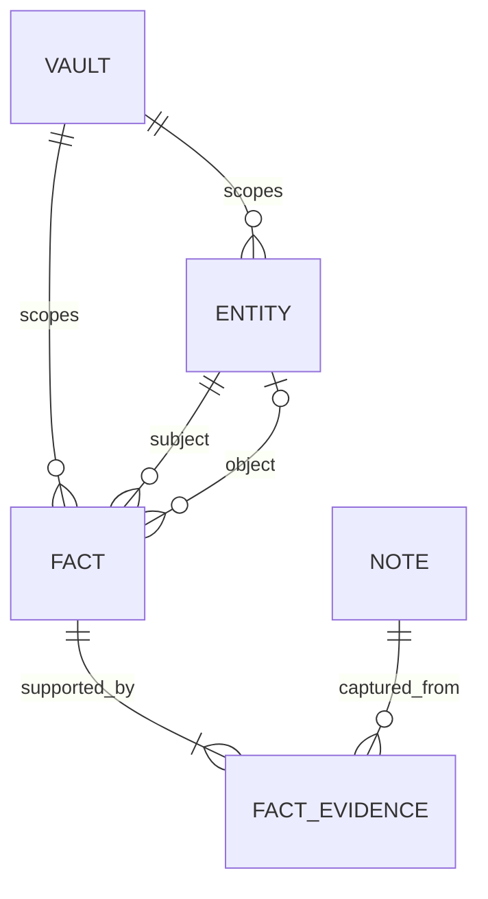

# Knowledge graph implementation plan

Status: proposed architecture; implementation awaits explicit approval.
Prepared: 2026-11-14.
Branch: `feature/knowledge-graph`, created from `origin/main` at `12cf6ed`.
Tasks: [todo.md](todo.md). Approve and implement one step at a time.

## Goal and first usable outcome

Build the local knowledge foundation that Dreamer can consume later. Through
shared Python operations and a small CLI, a user can create an entity, record a
fact supported by a captured note, retrieve the relationship and its evidence,
and see whether that evidence still matches the current capture.

Example: create project `Hippo` and technology `SQLite`; record
`Hippo --uses--> SQLite`, supported by a quote from a particular note revision.
Also support literal facts such as `Hippo --language--> "Python"`.

## Sources inspected

- `README.md`, `AGENTS.md`, `docs/specs/02-core-application-structure.md`, and
  `docs/architecture/component-structure.md`.
- `core/src/hippo/graph/README.md`; vault models, repository, CLI, config, and
  packaged schema validator; database migrations and migration guide.
- Obsidian project roadmap: `021 - Knowledge store and graph`,
  `023 - Retrieval and context compilation`, `025 - Core engine architecture`,
  `020 - data/model`, and `03 - Skill dreamer` with subcomponents 031/032.
- `core/src/hippo/evaluation/graph/README.md` remains a scaffold.

The repository architecture/spec status text and Obsidian progress checklists
predate parts of PR #2. The actual source implements manual capture, parsing,
FTS5 search, refresh, and schema compatibility. Checklist state alone is not
implementation evidence.

## Existing behavior and constraints

- One local SQLite database, explicit dbmate migrations, stdlib `sqlite3`, typed
  frozen dataclasses, Typer command groups, and Rich tables.
- `VaultRepository` currently owns connection setup, migration compatibility,
  foreign-key enforcement, writer transactions, and nested savepoints.
- `hippo.graph` has documentation only. No graph schema or graph SDK exists.
- Notes retain only the latest captured content/hash/revision. Deletion is soft;
  recovery creates a new active note ID. NoteIndex is derived and replaceable.
- Existing note processing state belongs to Markdown parsing. Graph operations
  must not repurpose it or introduce a second capture/index pipeline.
- Repositories do not create or migrate tables. New migration IDs must also be
  added to `hippo/schema.py`; the validator stays small.
- Manual execution remains the operating model. No scheduler, Docker sidecar,
  watcher, or persistent engine is required for this work.

## Architecture proposal

```text
hippo graph CLI / later Dreamer or MCP
                  |
          GraphService (rules)
                  |
       GraphRepository (parameterized SQL)
                  |
    existing SQLite database: entities, facts, evidence
                  |
     read captured Note identity/revision/content
```

- Keep behavior under `core/src/hippo/graph/`: `models.py`, `repository.py`,
  `service.py`, and `graph_app.py`. Add each file only when its behavior arrives.
- Register `graph_app` in the root `hippo/cli.py`; retain existing configuration,
  explicit database overrides, bounded pages, useful errors, literal-text table
  cells, and copyable help examples.
- Extract only the existing connection-opening and transaction helpers into
  `hippo/database.py` when the second repository needs them. Preserve the
  `VaultRepository(Path)` and `transaction()` interfaces and current behavior.
  No base-repository framework, pool, or connection manager service.
- A graph mutation validates note evidence and writes graph records on one
  connection in one transaction. Do not validate using one repository connection
  and then publish using another; that would leave a source-change race.
- Graph code reads note data to validate provenance; capture and index mutations
  remain owned by the vault component.

## Decisions to approve before schema implementation

### 1. Canonical graph storage

Recommendation: SQLite is canonical for manually curated entities, facts, and
evidence; JSON export preserves them. Markdown remains canonical for note text.
Rescanning notes cannot recreate manually entered assertions or review decisions.
Backups therefore matter independently of Markdown. Automatically extracted
assertions can be added later with their own provenance/version contracts.

This is an open decision in spec 021, not an already approved storage policy.

### 2. Vault scope

Recommendation: entities and facts belong to one registered vault. Their entity
references and note evidence must belong to that same vault. This matches current
vault-scoped search and avoids accidentally mixing knowledge from unrelated
vaults. Cross-vault entities/relationships require a separately reviewed change.
Vault scope is a data boundary, not a replacement for future MCP authorization.

### 3. Historical evidence

Recommendation: retain an immutable supporting quote with note ID, source
revision, content hash, vault-relative path at capture, and recorded timestamp.
Require the quote to occur exactly in the accepted note capture, with finite
input limits agreed during implementation. Check the expected revision under
the write transaction before recording evidence.

This retains useful evidence without adding full note-revision history. A hash
identifies the original text; it cannot reconstruct it. Full historical context
outside the saved quote remains unavailable after an edit.

## Proposed records and invariants

| Record | Responsibility and proposed minimum data |
| --- | --- |
| Entity | Stable integer ID, vault ID, name, type, created/updated UTC timestamps |
| Fact | Stable ID, vault ID, subject entity, predicate, exactly one object entity or nonblank text literal, created timestamp |
| Fact evidence | Stable ID, fact ID, immutable note-reference/quote snapshot, optional supplied confidence, recorded timestamp |
| Contradiction (later slice) | Explicit pair of fact IDs, recorded time, optional resolution with reason/time; preserve both facts |



`FACT` needs at least one evidence record when an application operation commits;
the service and repository transaction enforce the parent-plus-evidence write.
Foreign keys alone cannot enforce that minimum child count.

- Entity names are labels, not proof of identity. Allow homonyms; require IDs
  when linking facts. No automatic entity merge or global name uniqueness.
- Keep predicates as validated text initially; no ontology or predicate registry.
- Support text literals first. Distinguishing numbers, booleans, dates, and units
  can follow a concrete consumer requirement.
- Recognize exact duplicate facts by vault/subject/predicate/object kind/value
  with database uniqueness constraints. Reuse their identity and attach distinct
  evidence atomically. Do not infer semantic equivalence or contradiction.
- Repeating the same fact/evidence submission must not add duplicate evidence or
  inflate frequency. Use a defined evidence identity and a database unique key.
- Confidence is optional and attached to the supporting assertion/evidence;
  supplied values must be finite and within 0..1. No invented default confidence
  or automatic aggregation. Derive evidence counts rather than incrementing a
  stored frequency counter on retries. Agree on this refinement of spec 021.
- Missing/deleted sources reject new evidence. Existing evidence survives source
  edits/deletion and is labeled current, changed, or deleted from captured state.
  These labels do not claim that a fact is true/false or that disk was rescanned.
- Prevent hard deletion of referenced evidence sources/entities through foreign
  keys. Ordinary note soft deletion must continue to work without graph writes.
- Do not overwrite a fact's subject/predicate/object to correct it. Add a new
  assertion; design explicit retraction/resolution before exposing those writes.
  Reappearance at the same file path must not rebind old evidence to a new note.
- Preserve contradictory assertions; different values are not automatically
  contradictions because predicates can legitimately be multivalued.
- Validate sizes, IDs, and text at the shared operation boundary, enforce core
  integrity in SQL, and bind values. No note-content assumptions beyond existing
  captured UTF-8 contracts and explicit evidence validation.

## Delivery sequence

1. Reuse database connection/transaction rules without changing vault behavior.
2. Entity schema, records, and repository create/get/list operations.
3. Shared entity rules and manual CLI commands with examples.
4. Fact/evidence schema, records, and atomic persistence.
5. Shared fact/evidence validation and CLI create/read flows.
6. Bounded entity/predicate/source queries and one-hop relationship inspection,
   including source freshness and accumulated evidence.
7. Explicit contradiction recording/resolution that retains source history.
8. Inspectable JSON export and batched documentation/manual acceptance review.

These are review boundaries, not authorization to implement the whole list.
Later slice details remain proposed until reviewed. See `todo.md` for acceptance
criteria, likely files, and verification.

## Explicitly deferred

- LLM extraction, conversation ingestion, entity resolution, automatic
  contradiction detection, and automatic source revalidation.
- Embeddings, vector dependencies, relevance/decay formulas, semantic search,
  multihop/path algorithms, and graph visualization.
- Dreamer/workflow execution, MCP transports/tools, agent identity/permissions,
  background processing, sidecars, notifications, and cross-device sync.
- Automatic fact promotion, broad CRUD/delete commands, and full source-history
  storage. Add narrower correction operations when review requirements are clear.
- Automated tests, evaluation runners/datasets, and benchmark implementation.
  Existing evaluation scaffolds stay unchanged unless requested.

## Verification and migration policy

- No migrations run during planning. Leave the configured sandbox/user database
  unchanged until migration execution is explicitly included in an approved step.
- Use disposable databases for manual migration and repository walkthroughs;
  verify foreign keys, rollback, uniqueness, and reopened state. Never edit
  already-applied migration files. Clearly mark destructive development rollback.
- After SQL changes, update the packaged migration list and verify both existing
  vault operations and new graph operations open the supported schema.
- Reuse `just lint` and relevant build/whitespace checks. No automated tests are
  added, modified, or run without an explicit request.
- Review source edits/deletion, stale revisions, repeated submissions, homonyms,
  missing references, cross-vault references, invalid confidence, oversized
  input, pagination boundaries, writer locks, and partial-write rollback manually.
- Before release, export/reopen a representative graph and verify identities,
  Unicode literals, evidence snapshots, confidence, and contradiction history.

## Immediate approval checkpoint

First agree on canonical storage, vault scope, and evidence retention above.
Then approve only step 1 (shared SQLite connection/transaction helpers). That
step must preserve existing vault behavior; entity schema implementation receives
its own review and approval next. Commits and pushes remain with the user.
